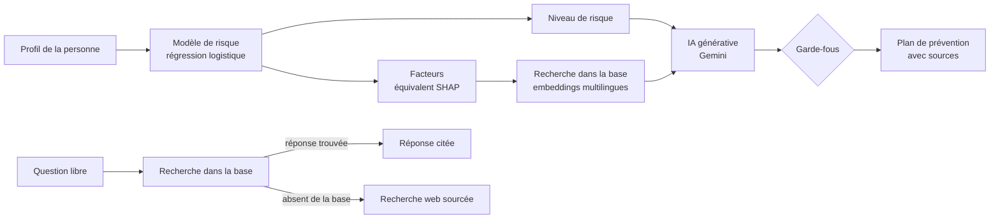

# GlucoSense AI

**Plateforme de sensibilisation et de prévention du diabète** : modèle de machine learning explicable, assistant RAG multilingue qui cite ses sources, plan de prévention généré par IA, tableaux de bord interactifs, le tout dans une application Streamlit de 9 pages.

**Démo en ligne : [ouvrir l'application](https://argued-violations-rings-expanding.trycloudflare.com)**
 · **Auteure : Aya Chraiet**

> Outil **pédagogique**. Il ne remplace ni un médecin, ni un diagnostic, ni un traitement.

## Pourquoi ce projet

Le diabète de type 2 peut rester silencieux pendant des années : selon l'IDF (Diabetes Atlas, 11e édition), 43 % des adultes diabétiques ne savent pas qu'ils le sont. GlucoSense aide une personne à **comprendre** la maladie, à **estimer son niveau de risque avec une explication**, à **poser ses questions** en obtenant des réponses **sourcées**, et à recevoir **un plan de prévention** adapté à son profil.

## Guide d'utilisation : que faire sur chaque page

| Page | À quoi elle sert | Comment l'utiliser |
|---|---|---|
| **Accueil** | Vue d'ensemble | Lire les chiffres clés (chacun cite sa source) et choisir une des 6 cartes |
| **Comprendre le diabète** | S'informer | 7 onglets : types (1, 2, gestationnel, autres), mécanisme illustré, symptômes et signes d'urgence, complications, diagnostic, idées reçues (cliquer pour voir la réponse), glossaire (champ de recherche) |
| **Évaluer mon risque** | Obtenir un niveau de risque expliqué | Remplir le formulaire (âge, grossesses, glycémie, poids, taille, tension, antécédents), cliquer sur « Voir mon niveau de risque », lire les facteurs, tester le simulateur « Et si ? » avec les deux curseurs, puis choisir la langue et générer son plan de prévention |
| **Poser une question** | Interroger l'assistant | Taper une question en français, English ou العربية, ou cliquer sur une idée de question ; ouvrir « Sources » pour vérifier d'où vient la réponse |
| **Médecins et traitements** | Préparer son parcours de soins | Quels spécialistes consulter, médicaments expliqués **sans aucune dose**, liste de préparation de consultation à cocher et à télécharger |
| **Vivre au quotidien** | Agir | Méthode de l'assiette, conseils, Ramadan, défi de 7 jours à cocher |
| **Chiffres et données** | Explorer les statistiques et le jeu de données | Onglet « Explorer » : régler la tranche d'âge, choisir une variable, lire les taux par tranche (l'effectif n est toujours affiché) |
| **Bibliothèque** | Lire les sources | Filtrer par thème, chercher un mot, ouvrir les documents officiels ; consulter les textes que lit l'assistant |
| **Méthode et limites** | Vérifier la rigueur | Schéma de fonctionnement, métriques, protections, limites |

## L'assistant : ce qu'il peut et ne peut pas faire

| Situation | Comportement |
|---|---|
| Question couverte par la base (types, prévention, symptômes, complications, diagnostic, médecins, médicaments en général, mode de vie, Ramadan) | Réponse rédigée **à partir des extraits**, avec citations `[1]`, `[2]` et sources dépliables |
| Question sur le diabète **absente de la base** | Recherche web avec liens vers les pages consultées, clairement signalée comme **non vérifiée par GlucoSense** |
| Question sans rapport avec le diabète ou la santé | Refus poli en trois langues |
| Demande de dose ou de traitement personnel | Aucune dose n'est jamais donnée ; renvoi vers un médecin ou un pharmacien |
| Demande de diagnostic (« ai-je le diabète ? ») | Pas de diagnostic ; renvoi vers un professionnel de santé |
| Signes graves (vomissements, haleine fruitée, confusion…) | Bannière d'urgence (190, SAMU en Tunisie) |
| Quota IA épuisé ou pas de clé API | Message clair ; le reste de l'application continue de fonctionner |

## Architecture



## Données et modèle

- **Données** : *Pima Indians Diabetes Database*, 768 femmes de 21 ans et plus (Smith, Everhart, Dickson, Knowler, Johannes, 1988, NIDDK). Les valeurs 0 impossibles (glycémie, tension, IMC, insuline, pli cutané) sont traitées comme des valeurs manquantes.
- **Protocole** : séparation train/test stratifiée (80/20), imputation par la médiane **dans le pipeline** pour éviter toute fuite d'information, comparaison de modèles par validation croisée à 5 plis, choix des variables et du seuil sur l'entraînement uniquement, jeu de test utilisé une seule fois.
- **Comparaison (validation croisée, AUC)** : régression logistique 0,844 · forêt aléatoire 0,836 · gradient boosting 0,813 · baseline 0,500. Les écarts sont inférieurs à l'écart-type : on retient le modèle le plus simple et le plus explicable.
- **Variables retirées** : `Insulin` (49 % de valeurs manquantes) et `SkinThickness` (30 %, coefficient nul), sans perte d'AUC (0,844 contre 0,847).
- **Seuil de décision** : 0,40, choisi pour un rappel d'environ 80 % (un cas manqué coûte plus qu'une fausse alerte).
- **Résultats sur le jeu de test (154 patientes)** : AUC 0,81, rappel 0,81, précision 0,57. Intervalles de confiance à 95 % (bootstrap) : rappel 0,71 à 0,91, précision 0,46 à 0,68, AUC 0,74 à 0,87.
- **Explicabilité** : pour un modèle linéaire, la contribution SHAP d'une variable est son coefficient multiplié par sa valeur normalisée. La glycémie pèse environ deux fois plus que l'IMC.

## Choix de conception et sécurité

| Risque | Réponse |
|---|---|
| Hallucination | Réponses fondées sur des extraits numérotés et cités ; sinon recherche web signalée comme non vérifiée |
| Dose ou diagnostic | Consignes strictes + filtre de sortie qui remplace toute réponse contenant une dose chiffrée |
| Question hors sujet | Détection du domaine + seuil de similarité (un seuil seul ne suffit pas : une question sur une dose de médicament obtient un score plus élevé qu'une question légitime en arabe) |
| Signes graves | Message d'urgence automatique |
| Faux sentiment de précision | Aucun pourcentage de risque affiché : le modèle est pondéré, ses scores ne sont pas des probabilités réelles |
| Explication trompeuse | Seuls les facteurs qui augmentent le niveau sont commentés : les contributions sont relatives à un profil moyen qui compte 61 % de personnes en obésité |
| Rôle de l'IA | Le niveau de risque vient uniquement du modèle, l'IA rédige et ne calcule rien |
| Modèle inadapté | Entraîné sur des femmes uniquement : la page de risque refuse les hommes |
| Quota de l'API gratuite | Cache partagé, limite de 30 appels IA par visiteur, modèles de secours, nouvelles tentatives |
| Confidentialité | Les questions et le profil (sans identité) sont envoyés à un service d'IA (Google Gemini) : un avertissement le précise |

## Structure du projet

```
glucosense-ai/
├── app.py                  # navigation de l'application
├── core/
│   ├── config.py           # chemins, seuils, secrets
│   ├── ml.py               # modèle, niveaux de risque, explication par profil
│   ├── content.py          # contenu pédagogique
│   ├── rag.py              # découpage, index de recherche (e5 multilingue ou TF-IDF)
│   ├── llm.py              # Gemini : cache, limites, nouvelles tentatives, recherche web
│   ├── assistant.py        # assistant, plan de prévention, garde-fous
│   └── ui.py               # style et illustrations SVG
├── views/                  # les 9 pages
├── knowledge_base/         # documents indexés par l'assistant (.txt)
├── data/                   # jeu de données, statistiques sourcées, bibliothèque
├── model/                  # modèle entraîné et configuration
└── scripts/                # entraînement et test de l'assistant
```

## Installation

**Sur ordinateur**
```bash
python -m venv .venv
.venv\Scripts\activate          # Windows  (Mac/Linux : source .venv/bin/activate)
pip install -r requirements.txt
streamlit run app.py
```

**Dans Google Colab** : monter Google Drive, copier le dossier du projet, installer `streamlit` et `google-genai`, lancer `streamlit run app.py` en arrière-plan et exposer le port 8501 avec un tunnel.

### Activer l'IA générative
1. Créer une clé sur Google AI Studio.
2. Copier `.streamlit/secrets.toml.example` en `.streamlit/secrets.toml` et renseigner `GOOGLE_API_KEY` (ce fichier est ignoré par Git).
3. Optionnel : `MODELES = "nom1,nom2"` pour imposer les modèles ; sinon l'application choisit des modèles « flash » de texte disponibles.

Sans clé, tout fonctionne sauf les réponses rédigées, la recherche web et le plan par IA : l'assistant affiche alors les extraits de la base.

### Ajouter des documents à l'assistant
Déposer des fichiers `.txt` dans `knowledge_base/` : première ligne `SOURCE: Organisme, titre, année`, une ligne vide entre les paragraphes, aucune dose de médicament. Ils sont indexés au démarrage et cités comme sources. **Remplacer `oms_demo.txt` par de vrais documents officiels.**

## Déploiement

L'application est déployée sur **Streamlit Community Cloud** (gratuit, dépôt GitHub public) : déposer le projet sur GitHub (`app.py` à la racine), créer l'application sur share.streamlit.io (branche `main`, fichier `app.py`), puis coller les secrets au format TOML (`GOOGLE_API_KEY = "..."`).

- Les ressources de la formule gratuite sont limitées. La recherche sémantique (`sentence-transformers`) est gourmande : en cas de dépassement, la retirer de `requirements.txt` fait basculer l'assistant sur une recherche par mots, moins précise entre les langues.
- Une application sans visite pendant 12 heures s'endort et se réveille au premier clic.
- Le modèle d'embeddings est téléchargé au démarrage à froid : la première question peut prendre une à deux minutes.
- Ne jamais publier de clé d'API dans le dépôt.

## Limites

- Un seul jeu de données, d'une seule population (femmes, 21 ans et plus) : à ne pas généraliser.
- Le « glucose » du jeu de données est la glycémie 2 heures après un test de charge, pas une glycémie à jeun.
- Les antécédents familiaux sont saisis par 3 choix qui approchent un score calculé.
- Les fiches pédagogiques intégrées (`core/content.py`) sont rédigées à partir de connaissances générales : à relire avec les sources officielles.
- La recherche web dépend d'un service externe, ses sources ne sont pas validées par le projet.
- Ce n'est pas un outil de diagnostic.

## Sources

OMS, aide-mémoire Diabète · IDF Diabetes Atlas, 11e édition (2025) · IDF, page Tunisie. Les liens exacts sont dans `data/statistiques.json` et `data/bibliotheque.json`.

## Pistes d'amélioration

Un questionnaire adapté au grand public sur un autre jeu de données, une évaluation systématique du RAG (30 questions de test, Hit@k), un reranker, une vraie base de documents officiels, des tests automatisés.

## Licence et avertissement

Projet pédagogique. Les documents cités appartiennent à leurs auteurs. Aucune information de cette plateforme ne constitue un avis médical.
